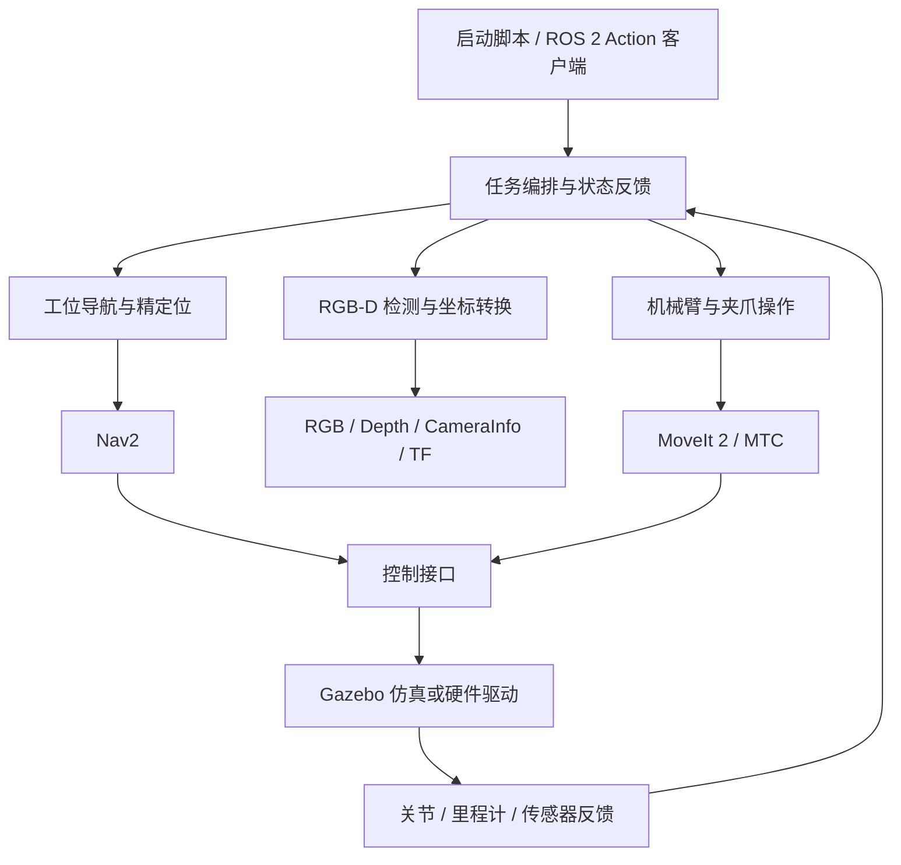

# LanderPi ROS 2 移动机械臂

基于 ROS 2 Humble 的移动机械臂工作区，将底盘导航、RGB-D 视觉、机械臂规划与夹爪控制组织为可追踪的分拣任务：

**导航到取货点 → 精定位 → 视觉检测 → 抓取 → 运输 → 放置 → 返航。**

项目包含机器人模型、底层驱动、统一任务接口、上层任务框架和 Gazebo 仿真。主要使用 Python 实现任务编排与视觉处理，使用 C++ 实现运动规划、控制适配和仿真插件。

当前可运行的主要场景包括单红箱分拣、仓库多颜色连续分拣，以及随臂 RGB-D 相机的定点视觉抓放。完整分拣闭环已在仿真中接通；实机抓放入口已提供，但尚未完成现场硬件验收。

## 系统架构



系统按任务、能力和设备接口分层：

| 层级 | 职责 | 主要代码 |
|---|---|---|
| 任务层 | 编排阶段、接收任务、报告进度、处理取消和故障 | `landerpi_task_manager`、仿真 runtime |
| 能力层 | 工位导航、精定位、检测、抓取与放置 | `landerpi_navigation`、`landerpi_fine_alignment`、`landerpi_perception`、`landerpi_manipulation` |
| 规划与控制层 | 路径规划、碰撞场景、关节轨迹和夹爪控制 | `landerpi_moveit_config`、`landerpi_mtc_grasp`、`landerpi_robot_adapter` |
| 设备与模型层 | 板卡、舵机、传感器、URDF、Gazebo 插件 | `driver`、`peripherals`、`landerpi_description`、`landerpi_simulation` |
| 支撑层 | 统一消息、状态监控、实验记录、组合启动 | `landerpi_task_interfaces`、`landerpi_robot_monitor`、`landerpi_experiment_tools`、`landerpi_bringup` |

需要区分接口设计与当前实现：多个上层能力包仍是实机适配框架；可运行的导航分拣实现主要集中在 `landerpi_simulation` 的 runtime 中，并通过统一 Action 暴露能力。不能仅根据包名判断对应实机功能已完成。

## 代码目录

```text
src/
  driver/                     板卡通信、底盘、舵机与原始运动学驱动
  peripherals/                深度相机、雷达、IMU、手柄等外设入口
  calibration/                校准工具与配置
  landerpi_description/       机器人 Xacro、网格和可视化配置
  landerpi_task_interfaces/   任务、导航、感知与操作的 Action / msg / srv
  landerpi_task_manager/      基础任务状态机和 dry_run Action 服务
  landerpi_navigation/        工位导航接口框架
  landerpi_fine_alignment/    精定位接口框架
  landerpi_perception/        检测器、深度投影及感知服务框架
  landerpi_manipulation/      操作服务、后端和规划场景接口框架
  landerpi_moveit_config/     规划组、运动学、限速与控制器配置
  landerpi_mtc_grasp/         随臂相机视觉抓放及实机接口
  landerpi_robot_adapter/     底盘、机械臂、夹爪与状态适配框架
  landerpi_robot_monitor/     机器人状态监控框架
  landerpi_experiment_tools/  任务 CSV 记录与测试辅助
  landerpi_bringup/           任务系统与仿真组合启动
  landerpi_simulation/        Gazebo 场景、控制插件与分拣 runtime
launch/                       原硬件组合启动入口
tools/                        构建、启动和验收脚本
docs/                         部署、接口契约与仿真说明
archive/                      历史备份，不参与构建
```

## 核心代码逻辑

### 1. 基础任务框架

[task_manager_node.py](src/landerpi_task_manager/landerpi_task_manager/task_manager_node.py) 提供 `/task/execute_sort` Action 服务；[state_machine.py](src/landerpi_task_manager/landerpi_task_manager/state_machine.py) 定义任务阶段及循环顺序；[task_context.py](src/landerpi_task_manager/landerpi_task_manager/task_context.py) 保存任务上下文。

任务从自检、空闲进入准备、导航、检测、抓取、运输和放置阶段，根据数量重复任务周期，按请求决定是否返航。Action 用于表达长时间任务的目标、进度、结果和取消请求；消息与服务定义集中在 [landerpi_task_interfaces](src/landerpi_task_interfaces)。

该入口默认是 `dry_run`，用于验证状态转换和接口行为，不发送运动命令。基础框架的 `live` 模式在真实后端接通前拒绝任务。实际仿真分拣使用下面的独立 runtime。

### 2. 单物体导航分拣

[sort_runtime.py](src/landerpi_simulation/scripts/sort_runtime.py) 中的 `Runtime` 集中实现仿真 Action 服务，并调用 Nav2、MoveIt、轨迹控制器和 Gazebo 服务。

一次任务依次执行：

1. 检查关节、传感器、TF、Nav2 与 MoveIt 是否就绪。
2. 通过 Nav2 到达取货工位，再根据仿真里程计低速修正位姿。
3. 获取 RGB-D 图像，用颜色分割定位目标，结合相机内参、深度和 TF 得到三维位置。
4. 更新 MoveIt 碰撞场景，执行接近、闭爪、附着、抬升与运输姿态动作。
5. 导航到放置工位，下降、释放物体、撤臂，并检查实际落点。
6. 根据请求返航，返回 Action 结果并记录任务 CSV。

任务运行中持续处理取消和超时。导航与检测采用有限重试；抓取后的操作失败进入故障状态，避免直接释放正在夹持的物体。完整接口及故障行为见 [完整分拣仿真](docs/full_simulation.md)。

### 3. 仓库连续分拣

[warehouse_runtime.py](src/landerpi_simulation/scripts/warehouse_runtime.py) 的 `WarehouseRuntime` 继承 `Runtime`，复用运动控制、动作调用和故障处理，并扩展多颜色检测、库存检查、目标盒槽位分配和连续任务循环。

场景布局与货物配置由 [warehouse.yaml](src/landerpi_simulation/config/warehouse.yaml) 等配置文件描述。默认九盒地面场景包含六个源盒与三个颜色终点盒，将五件红、绿、蓝货物送往对应终点后返航。布局和运行方式见 [仓库连续分拣](docs/warehouse_simulation.md)。

### 4. 定点视觉抓放

独立视觉抓放入口位于 `landerpi_mtc_grasp`，不依赖导航分拣任务循环：

- [color_vision.py](src/landerpi_mtc_grasp/scripts/color_vision.py)：处理随臂相机 RGB-D 数据，完成颜色分割、深度投影及图像时刻的 TF 转换，发布目标位姿。
- [color_grasp.cpp](src/landerpi_mtc_grasp/src/color_grasp.cpp)：组织观察、接近、闭爪、抬升、左侧地面放置与撤臂等 MTC 阶段。
- [hardware_servo.py](src/landerpi_mtc_grasp/scripts/hardware_servo.py)、[mtc_joystick.py](src/landerpi_mtc_grasp/scripts/mtc_joystick.py)：提供实机舵机反馈、轨迹执行和手柄交互入口。

物体检测坐标来自 RGB-D 与 TF。仿真中的物理附着、抬升和落点验证由 Gazebo 配合完成；实机使用真实舵机反馈，尚不能通过夹持力或在爪传感器确认抓取成功。

## 环境与快速开始

以下命令在工作区根目录执行，面向 ROS 2 Humble、Gazebo Classic、Nav2 和 MoveIt 2 环境。依赖安装细节见 [完整仿真说明](docs/full_simulation.md)。

### 构建与单物体分拣

已安装 ROS 2 Humble 并配置 ROS apt 软件源后，可用项目脚本下载本地 Nav2 依赖，再构建仿真包：

```bash
python3 tools/install_local_nav2.py
bash tools/build_simulation.sh
bash tools/run_sort_demo.sh
```

依赖下载到 `.deps/`，运行脚本会加载本地环境。启动后打开 Gazebo 与 RViz，自动运行一次分拣任务；完成后保留界面，使用 Ctrl+C 退出。

```bash
# 仅启动系统，由客户端另行发送任务
bash tools/run_sort_simulation.sh

# 无界面自动运行
bash tools/run_sort_demo.sh gui:=false rviz:=false

# 仓库多颜色连续分拣
bash tools/run_warehouse_demo.sh
```

### 定点视觉抓放仿真

在上述仿真环境基础上安装 MTC 依赖并单独构建抓放包：

```bash
python3 tools/install_local_mtc.py
source /opt/ros/humble/setup.bash
source install/setup.bash
source tools/simulation_env.sh
colcon build --packages-select landerpi_mtc_grasp --symlink-install
source install/setup.bash
bash tools/run_mtc_color_grasp.sh target_color:=red
```

颜色可选 `red`、`green`、`blue`，无界面可添加 `gui:=false rviz:=false`。任务会自动观察、识别、抓取并将物体放到车体左侧地面，无需手柄。

### 基础状态机演示

只验证任务接口和状态流转时，可构建并启动基础框架：

```bash
source /opt/ros/humble/setup.bash
colcon build --symlink-install --packages-up-to landerpi_bringup --parallel-workers 2
source install/setup.bash
ros2 launch landerpi_bringup task_system.launch.py
```

另一终端加载 ROS 与工作区环境后发送任务：

```bash
source /opt/ros/humble/setup.bash
source install/setup.bash
ros2 action send_goal /task/execute_sort \
  landerpi_task_interfaces/action/ExecuteSortTask \
  '{task_id: dry_001, object_class: box, pick_station: pick_station, place_station: place_station, quantity: 1, return_home: false}' \
  --feedback
```

此命令对应 `dry_run` 框架。单物体仿真的工位、目标类别及 ROS 域不同，手动发送仿真任务请参照 [仿真接口说明](docs/full_simulation.md)。

## 验证

基础框架构建后，在已加载 ROS 与工作区环境的终端中运行：

```bash
python3 tools/test_framework.py
python3 tools/test_task_action.py
```

覆盖框架和 Action 的成功、取消、超时、任务互斥及未就绪后端拒绝等行为。

```bash
# 完整仿真验收，需要已安装仿真依赖并完成构建
bash tools/run_sort_test.sh

# 多轮任务与故障场景
bash tools/run_sort_test.sh --runs 10 --grasp-runs 10 --fault-check
```

仿真验收除检查任务结果外，还读取物体落点、附着状态、返航位姿、关节反馈及规划场景。已有记录见 [仿真验证记录](docs/simulation_test_report.md)；历史记录不代表在任意机器上都有相同成功率或耗时。

## 能力范围与硬件接入

- 机器人模型为五轴机械臂加夹爪，使用位置 IK，不具备任意六自由度末端姿态能力。
- 仿真底盘为理想全向模型，使用 Gazebo 真值里程计；当前场景未验证真实 SLAM、AMCL 定位或轮速误差。
- 视觉以已知尺寸、直立物块的颜色检测为主，未实现通用物体识别与复杂 6D 位姿估计。
- 仿真抓取采用带闭爪和距离条件的刚性附着，不能据此推断实物的摩擦抓取成功率。
- 导航与机械臂操作分阶段进行，未实现移动中操作或底盘与机械臂联合规划。
- 实机运行需要板卡、舵机、相机、设备权限及标定配置。当前工作区的实机接口验证不替代现场硬件验收。

硬件接入请先阅读 [硬件接口盘点](docs/hardware_interface_inventory.md)、[TF 契约](docs/tf_contract.md) 和 [原硬件部署说明](docs/hardware_migration_original.md)。原始驱动引用的 `forward_kinematics.so`、`inverse_kinematics.so` 缺少对应源码，未纳入仓库；当前 MoveIt 仿真不依赖它们，运行旧运动学驱动时需另行提供。

构建产物、下载依赖、原始日志和历史备份由 `.gitignore` 排除。底层驱动与模型含既有代码及资源，使用和再分发时应保留各文件及包内的版权与许可声明。
