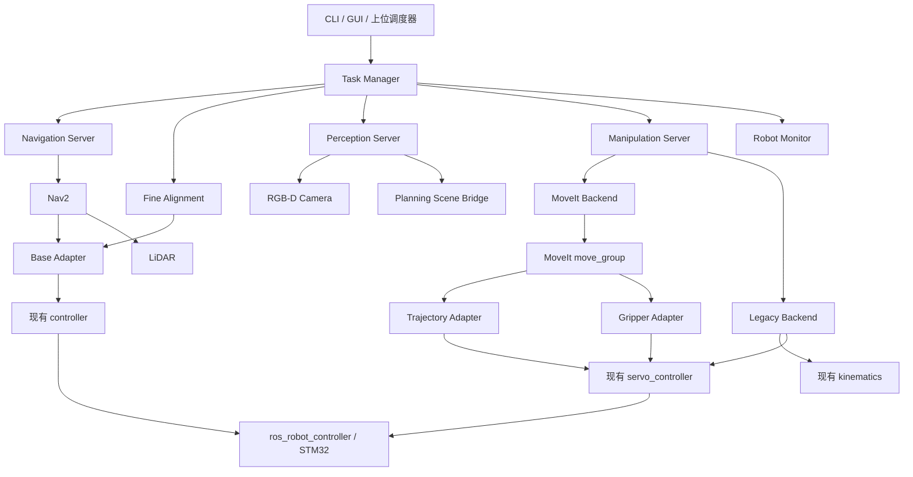
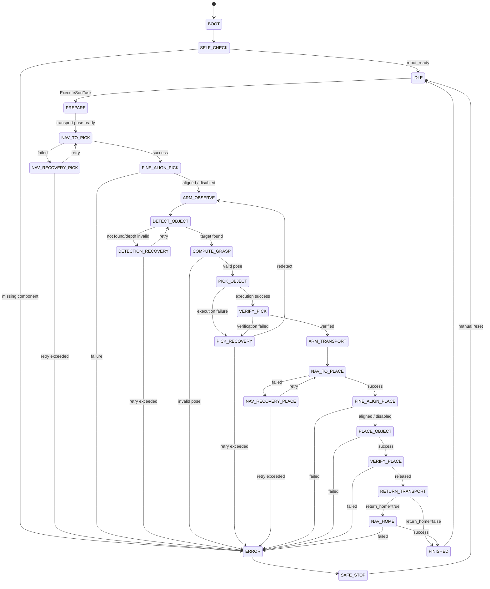
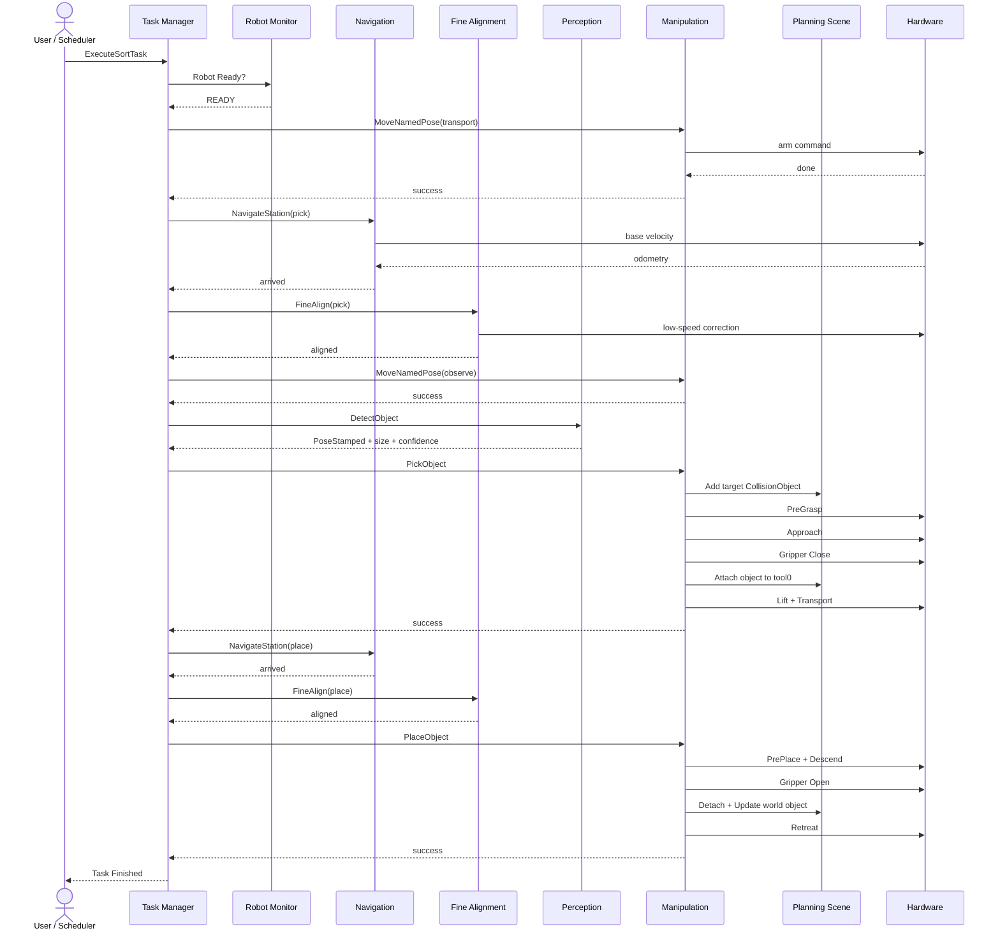
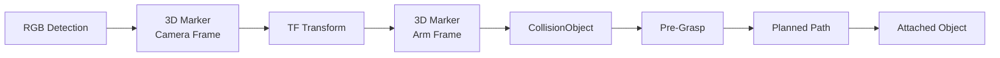
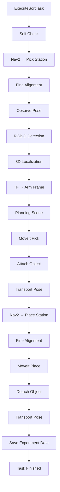

# LANDERPI_TASK_LAYER_WITH_MOVEIT.md — LanderPi 移动机械臂物流分拣上层任务层设计规范

## 执行摘要

本文档面向当前已经具备硬件基础的 LanderPi 移动操作机器人，目标是把现有的**幻尔麦克纳姆轮底盘 + 六轴机械臂 + 夹爪 + 激光雷达 + 深度相机**整合成一个可自主完成物流分拣任务的 ROS 2 系统，并将本文档作为后续其他 AI、项目成员和开发者编写代码时的**主要架构依据、接口契约和验收规范**。

已生成可直接保存、提交给其他 AI 使用的 Markdown 文件：

**[下载 LANDERPI_TASK_LAYER_WITH_MOVEIT.md](sandbox:/mnt/data/LANDERPI_TASK_LAYER_WITH_MOVEIT.md)**

根据你提供的硬件 README，当前移植工程已经保留 STM32 控制板及 `/dev/rrc` 串口通信、底盘运动学和里程计、总线舵机控制、机械臂运动学、雷达/相机/IMU 启动、机器人 URDF/TF 等基础能力；README 还明确指出，导航、SLAM、AI 视觉等上层功能并未包含在当前移植包中。因此，本项目的正确方向不是重新编写底层，而是在现有驱动之上构建标准化 Adapter、Nav2、MoveIt 2、Perception 和 Task Manager。当前机械臂 `kinematics` 中还包含预编译 `.so`，CPU 架构或 Python ABI 变化可能带来兼容问题，这也是本文建议保留 Legacy Backend、同时逐步接入 MoveIt 2 的原因之一。fileciteturn0file0

你原来的创新训练计划书已经把 Nav2、MoveIt2、视觉识别、物流仓储闭环和模块化 ROS 2 架构作为主要技术路线，并明确提出从仿真逐步迁移到实物平台；因此现在把范围收敛成“单台麦轮移动机械臂首先完成导航—识别—抓取—运输—放置闭环”，不会改变原项目的技术主线，反而更适合作为第一阶段可以真实验收的工程成果。fileciteturn0file1

ROS 2 官方 Action 设计将 Action 定义为适用于长时间、可反馈进度、可返回结果并可取消的任务接口，其 `.action` 文件由 Goal、Result、Feedback 三部分组成。这与导航、抓取、放置和完整物流任务高度匹配，因此本文把这些长时间任务全部设计为 Action，而不是使用普通 Topic 或 `sleep()` 等待。citeturn14search7

MoveIt 2 官方架构也支持本文采用的“渐进式接入”：`move_group` 本身**不会替机器人提供 JointState 或真实控制器**，而是读取机器人状态和 TF，并通过 `FollowJointTrajectory` 等接口与控制器通信；官方还明确指出，不强制机器人一定采用 `ros2_control`，也可以提供兼容的自有 Action 控制接口。因此最适合 LanderPi 当前状态的方案是：**保留幻尔 STM32 / `servo_controller`，增加一个标准 FollowJointTrajectory Adapter，让 MoveIt 2 先负责规划、IK 和碰撞检测。** citeturn15search2turn15search3

整个最终任务链定义为：

```text
BOOT
↓
SELF_CHECK
↓
IDLE
↓
接收 ExecuteSortTask
↓
机械臂进入运输位
↓
Nav2 导航到抓取工位
↓
Fine Alignment 工位精定位
↓
机械臂进入观察位
↓
RGB-D 识别物体
↓
计算目标三维坐标
↓
TF 转到机械臂规划坐标系
↓
Planning Scene 加入目标和环境
↓
MoveIt 2 生成抓取轨迹
↓
夹爪抓取
↓
目标 Attach 到 tool0
↓
机械臂进入运输姿态
↓
Nav2 导航到放置工位
↓
Fine Alignment
↓
MoveIt 2 规划放置
↓
释放夹爪
↓
Detach 目标并更新 Planning Scene
↓
机械臂返回运输位
↓
FINISHED
↓
保存 CSV 实验数据
```

核心架构为：



本设计的核心原则只有一句话：

> **任务层只知道“我要导航、识别、抓取、放置”，功能层只知道“怎样完成自己的任务”，Adapter 只知道“怎样把标准 ROS 2 接口翻译成幻尔现有硬件接口”。**

## 目标、范围与验收标准

**项目最终目标**

项目完成后，操作者只需要启动：

```bash
ros2 launch landerpi_bringup task_system.launch.py
```

系统进入：

```text
BOOT → SELF_CHECK → IDLE
```

随后发送一个：

```text
ExecuteSortTask
```

机器人应能够在不进行人工遥控的情况下完成：

```text
起点
  ↓
抓取工位
  ↓
识别物体
  ↓
视觉引导抓取
  ↓
运输
  ↓
放置工位
  ↓
自动放置
  ↓
任务完成
```

**MVP 范围**

第一阶段 MVP 只解决：

```text
1 台移动机器人
+
1 套六轴机械臂
+
1 个夹爪
+
1 个深度相机
+
1 个二维雷达
+
1 个抓取工位
+
1 个放置工位
+
规则物流物体
```

不应一开始增加：

```text
多机器人调度
动态抓取
移动中机械臂操作
复杂堆叠
任意未知物体
力控制
复杂 6D Pose
强化学习
大规模仓储调度
```

先把单机移动操作闭环做稳定，再扩展。

**MVP 工程验收标准**

下面数值属于本项目建议采用的**初始工程验收线**，并非幻尔硬件厂商性能保证。完成第一轮基线测试后，应依据实机能力形成 v1.1 验收指标。

| 子系统 | MVP 验收内容 | 建议验收线 |
|---|---|---|
| 硬件启动 | STM32、底盘、雷达、相机、机械臂全部可被 ROS 2 发现 | 连续启动无关键报错 |
| TF | `map → odom → base_link → sensor/arm → tool0` 连通 | 不存在关键断链和重复动态 TF |
| 底盘 | vx/vy/wz 均可控制 | 前后、横移、旋转方向全部正确 |
| Nav2 | Start → Pick → Place | 10 轮至少 9 轮成功 |
| 工位停车 | 机器人进入机械臂工作区 | 精度满足后续视觉补偿；如不满足则启用 Fine Alignment |
| RGB-D | 输出正确 `PoseStamped` | 三维误差建议先以 ≤20–30 mm 为工程目标 |
| MoveIt 规划 | 到多个抓取位规划成功 | 不违反 joint limits，不与已知环境碰撞 |
| 视觉抓取 | 目标在规定区域随机摆放 | 20 次至少成功 16 次 |
| 运输 | 抓取物体后自主导航 | 机械臂始终保持运输位 |
| 放置 | 物体进入目标区域 | 放置后机械臂安全退出 |
| 完整任务 | Navigate→Detect→Pick→Navigate→Place | 10 次至少成功 8 次 |
| 错误恢复 | 无目标、导航失败、规划失败等 | 有结构化错误码和有限次数重试 |
| Cancel | 执行期间取消任务 | 不再创建新运动 Goal，并取消当前可取消动作 |
| 数据 | 每轮任务 | 必须输出 CSV 记录 |

Nav2 的官方机器人设置要求核心坐标关系至少包括 `map→odom`、`odom→base_link` 和 `base_link→sensor`，其中全局定位/SLAM 通常负责 `map→odom`，局部里程计负责 `odom→base_link`，机器人描述负责传感器相对于底盘的坐标关系。citeturn14search0turn14search11

**扩展验收项**

MVP 稳定后再逐步加入：

| 扩展项 | 目标 |
|---|---|
| YOLO 多类别分拣 | 多种箱体/物品按类别送到不同工位 |
| 6D 姿态 | 处理非固定朝向目标 |
| 点云 Planning Scene | 深度相机实时环境三维障碍 |
| MoveIt Task Constructor | 多阶段 Pick/Place 自动求解 |
| MPPI | 更复杂动态环境下的全向底盘控制 |
| 自动抓取验证 | 视觉或夹爪反馈确认是否抓住 |
| 完整 ros2_control | 用标准 Hardware Interface 替代中间执行 Adapter |
| 多任务队列 | 连续处理多件货物 |
| 多机器人 | 在单机闭环成熟后恢复原计划的中央调度/分布式执行架构 |

**当前必须视为【待确认】的信息**

你的 README 已经说明“有哪些包”，但没有给出这些包运行后的完整 ROS 接口，因此下列内容禁止 AI 根据习惯猜测：fileciteturn0file0

```text
【待确认】底盘实际速度命令 Topic
【待确认】底盘实际速度命令消息类型
【待确认】里程计 Topic
【待确认】odom/base_link 实际名称

【待确认】IMU Topic 和 Frame
【待确认】LaserScan Topic 和 Frame

【待确认】RGB Topic
【待确认】Depth Topic
【待确认】CameraInfo Topic
【待确认】RGB 与 Depth 是否已对齐
【待确认】PointCloud Topic
【待确认】相机 optical frame

【待确认】六个机械臂 joint 名
【待确认】JointState 是否已经发布
【待确认】现有机械臂控制 Topic / Service
【待确认】现有 kinematics Service
【待确认】机械臂 base frame
【待确认】tool/end-effector frame

【待确认】夹爪控制接口
【待确认】夹爪是否有位置、电流或力反馈
```

第一阶段必须执行：

```bash
ros2 node list
ros2 topic list -t
ros2 service list -t
ros2 action list -t
ros2 param list

ros2 topic info <topic> -v
ros2 topic echo <topic> --once
ros2 action info <action>
ros2 service type <service>

ros2 run tf2_tools view_frames
ros2 run tf2_ros tf2_echo <parent> <child>
```

并进行源码调查：

```bash
rg "create_(publisher|subscription|service)" src/driver src/peripherals

rg "ActionServer|ActionClient|create_server|create_client" \
   src/driver src/peripherals

rg "frame_id|child_frame_id|joint" \
   src/driver src/peripherals src/simulations
```

最终生成：

```text
docs/hardware_interface_inventory.md
```

以后其他 AI **不得绕过该文件自行推测硬件接口**。

## 系统架构、软件包和接口契约

MoveIt 官方推荐为机器人建立独立的 `*_moveit_config` colcon 包，典型配置包含 `kinematics.yaml`、`joint_limits.yaml`、规划器配置和 `moveit_controllers.yaml`；URDF 描述物理结构，SRDF 描述 planning group、默认姿态、末端执行器、自碰撞等语义信息。MoveIt Setup Assistant 是生成这些配置的标准工具。citeturn15search0turn15search6turn15search7

**推荐目录结构**

```text
landerpi_ws/
├── src/
│   │
│   ├── driver/                               # 已有，尽量不改
│   ├── peripherals/                          # 已有
│   ├── calibration/                          # 已有
│   ├── simulations/
│   │   └── landerpi_description/             # 已有 URDF / TF
│   │
│   ├── landerpi_task_interfaces/
│   │   ├── action/
│   │   │   ├── ExecuteSortTask.action
│   │   │   ├── DetectObject.action
│   │   │   ├── PickObject.action
│   │   │   ├── PlaceObject.action
│   │   │   ├── MoveToPose.action
│   │   │   ├── MoveToJoint.action
│   │   │   ├── MoveNamedPose.action
│   │   │   ├── NavigateStation.action
│   │   │   └── FineAlign.action
│   │   ├── msg/
│   │   │   └── RobotStatus.msg
│   │   └── srv/
│   │       └── ResetFaults.srv
│   │
│   ├── landerpi_robot_adapter/
│   │   ├── src/
│   │   │   ├── base_adapter_node.cpp
│   │   │   ├── arm_trajectory_adapter_node.cpp
│   │   │   ├── gripper_adapter_node.cpp
│   │   │   └── robot_state_adapter_node.cpp
│   │   ├── config/
│   │   │   └── hardware_interfaces.yaml
│   │   └── launch/
│   │       └── adapters.launch.py
│   │
│   ├── landerpi_moveit_config/
│   │   ├── config/
│   │   │   ├── landerpi.srdf
│   │   │   ├── kinematics.yaml
│   │   │   ├── joint_limits.yaml
│   │   │   ├── moveit_controllers.yaml
│   │   │   ├── ompl_planning.yaml
│   │   │   └── moveit.rviz
│   │   └── launch/
│   │       ├── move_group.launch.py
│   │       └── moveit_rviz.launch.py
│   │
│   ├── landerpi_navigation/
│   │   ├── src/
│   │   │   └── station_navigator_node.cpp
│   │   ├── config/
│   │   │   ├── navigation.yaml
│   │   │   └── stations.yaml
│   │   └── launch/
│   │       └── navigation.launch.py
│   │
│   ├── landerpi_fine_alignment/
│   │   ├── src/
│   │   │   └── fine_alignment_server.cpp
│   │   ├── config/
│   │   │   └── fine_alignment.yaml
│   │   └── launch/
│   │       └── fine_alignment.launch.py
│   │
│   ├── landerpi_perception/
│   │   ├── landerpi_perception/
│   │   │   ├── perception_server.py
│   │   │   ├── detector_base.py
│   │   │   ├── detector_color.py
│   │   │   ├── detector_apriltag.py
│   │   │   ├── detector_qr.py
│   │   │   ├── detector_yolo.py
│   │   │   ├── depth_localizer.py
│   │   │   └── marker_publisher.py
│   │   ├── config/
│   │   │   └── perception.yaml
│   │   └── launch/
│   │       └── perception.launch.py
│   │
│   ├── landerpi_manipulation/
│   │   ├── src/
│   │   │   ├── manipulation_server.cpp
│   │   │   ├── moveit_backend.cpp
│   │   │   ├── legacy_backend.cpp
│   │   │   ├── planning_scene_bridge.cpp
│   │   │   └── grasp_planner.cpp
│   │   ├── config/
│   │   │   ├── arm_pose.yaml
│   │   │   └── grasp.yaml
│   │   └── launch/
│   │       └── manipulation.launch.py
│   │
│   ├── landerpi_robot_monitor/
│   │   ├── src/
│   │   │   └── robot_monitor_node.cpp
│   │   ├── config/
│   │   │   └── monitor.yaml
│   │   └── launch/
│   │       └── monitor.launch.py
│   │
│   ├── landerpi_task_manager/
│   │   ├── landerpi_task_manager/
│   │   │   ├── task_manager_node.py
│   │   │   ├── state_machine.py
│   │   │   ├── task_context.py
│   │   │   └── error_codes.py
│   │   ├── config/
│   │   │   └── task.yaml
│   │   └── launch/
│   │       └── task_manager.launch.py
│   │
│   ├── landerpi_experiment_tools/
│   │   ├── landerpi_experiment_tools/
│   │   │   ├── experiment_logger.py
│   │   │   └── benchmark_runner.py
│   │   └── config/
│   │       └── experiment.yaml
│   │
│   └── landerpi_bringup/
│       ├── config/
│       │   └── system.yaml
│       └── launch/
│           ├── upper_stack.launch.py
│           └── task_system.launch.py
│
└── docs/
    ├── hardware_interface_inventory.md
    ├── tf_contract.md
    ├── safety_checklist.md
    └── test_report_template.md
```

**软件包职责总表**

| Package | 节点 | 核心职责 |
|---|---|---|
| `landerpi_task_interfaces` | 无运行节点 | 全系统统一 msg/srv/action |
| `landerpi_robot_adapter` | `base_adapter` | 幻尔底盘接口 ↔ 上层标准接口 |
|  | `arm_trajectory_adapter` | `FollowJointTrajectory` ↔ 幻尔机械臂接口 |
|  | `gripper_adapter` | 标准夹爪 Action ↔ 幻尔夹爪 |
|  | `robot_state_adapter` | 统一 `/joint_states`、硬件状态 |
| `landerpi_moveit_config` | `move_group` | MoveIt 模型、IK、规划、碰撞、控制器配置 |
| `landerpi_navigation` | `station_navigator` | 工位名 ↔ Nav2 `NavigateToPose` |
| `landerpi_fine_alignment` | `fine_alignment_server` | 到站后的低速精定位 |
| `landerpi_perception` | `perception_server` | RGB-D 识别、3D 定位、TF |
| `landerpi_manipulation` | `manipulation_server` | 统一 MoveIt/legacy 的抓放接口 |
|  | `planning_scene_bridge` | CollisionObject / Attach / Detach |
| `landerpi_robot_monitor` | `robot_monitor` | 整机就绪状态、掉线、TF/数据时效 |
| `landerpi_task_manager` | `task_manager` | 总任务 FSM |
| `landerpi_experiment_tools` | `experiment_logger` | CSV 和实验指标 |
| `landerpi_bringup` | Launch | 一键启动整套系统 |

**节点级接口契约**

| 节点 | Topic 输入 | Topic 输出 | Action / Service | Parameters | TF 输入/输出 | Launch | 最小测试 |
|---|---|---|---|---|---|---|---|
| `base_adapter` | `/cmd_vel`；底层 odom【待确认】 | 底层 cmd【待确认】；规范 `/odom` | `/base/stop` 可选 | 底层 topic/type、速度限制 | `odom/base_link`，是否发布由参数决定 | `adapters.launch.py` | 架空轮分别测试 vx/vy/wz |
| `arm_trajectory_adapter` | `/joint_states` | 幻尔 arm command【待确认】 | `/arm_controller/follow_joint_trajectory` | joint map、offset、sign、timeout | 无直接输出 | 同上 | 小幅轨迹+Cancel |
| `gripper_adapter` | Action Goal | 幻尔 gripper command【待确认】 | `/gripper_controller/gripper_cmd` | 开闭值、超时 | 无 | 同上 | Open/Close |
| `robot_state_adapter` | 舵机反馈【待确认】 | `/joint_states` | 无 | joint name、stale timeout | robot_state_publisher 消费其状态 | 同上 | `ros2 topic hz /joint_states` |
| `station_navigator` | stations YAML | Action feedback | `/navigation/navigate_station` | timeout | `map/base_link` | `navigation.launch.py` | 导航到 `pick_station` |
| `fine_alignment_server` | Tag/视觉/雷达观测 | 低速 cmd | `/fine_alignment/align` | 模式、容差、最大速度 | sensor→base | `fine_alignment.launch.py` | 人工偏置后闭环 |
| `perception_server` | RGB/Depth/Info【待确认】 | debug image、Marker | `/perception/detect_object` | detector、ROI、frame | camera→output_frame | `perception.launch.py` | 返回 PoseStamped |
| `manipulation_server` | `/joint_states` 等 | Action feedback | Pick/Place/Move actions | backend、group、profile | planning frame/arm/tool | `manipulation.launch.py` | Plan-only→Execute |
| `robot_monitor` | 全系统关键 Topic | `/robot/status` | `/robot/reset_faults` | stale timeout | 检查 TF | `monitor.launch.py` | 关闭传感器验证 |
| `task_manager` | `/robot/status` | task feedback/result | `/task/execute_sort` | retry/timeout | 只查询 TF | `task_manager.launch.py` | Stub 全流程 |

MoveIt `move_group` 需要来自机器人的 JointState 和 TF，而不会替机器人创建 JointState 发布器；真实控制器也需要由机器人自己提供。官方 MoveIt 控制器文档以 `FollowJointTrajectory` 和 `GripperCommand` 为标准控制器接口，并明确控制器运行属于 MoveIt 之外的部分。citeturn15search2turn15search3

**Adapter 配置**

```yaml
# landerpi_robot_adapter/config/hardware_interfaces.yaml

base:
  upper_cmd_topic: /cmd_vel
  upper_odom_topic: /odom

  hardware_cmd_topic: TODO_CONFIRM
  hardware_cmd_type: TODO_CONFIRM

  hardware_odom_topic: TODO_CONFIRM
  hardware_odom_type: TODO_CONFIRM

  odom_frame: odom
  base_frame: base_link

  # 必须保证整个系统只有一个 odom -> base_link 发布者
  publish_odom_tf: false

arm:
  joint_state_source: TODO_CONFIRM
  hardware_command_interface: TODO_CONFIRM

  trajectory_action: /arm_controller/follow_joint_trajectory

  joints:
    - TODO_JOINT_1
    - TODO_JOINT_2
    - TODO_JOINT_3
    - TODO_JOINT_4
    - TODO_JOINT_5
    - TODO_JOINT_6

gripper:
  hardware_interface: TODO_CONFIRM
  action: /gripper_controller/gripper_cmd
  joint: TODO_GRIPPER_JOINT

  open_position: TODO_MEASURE
  closed_position: TODO_MEASURE
```

若幻尔已有接口只是名称不同而**消息类型完全一致**，优先使用 ROS remap：

```python
Node(
    package="existing_controller",
    executable="controller_node",
    remappings=[
        ("/existing_cmd_topic", "/cmd_vel"),
        ("/existing_odom_topic", "/odom"),
    ],
)
```

如果消息结构不同，再编写 Adapter。

**TF 契约**

```text
map
└── odom
    └── base_link
        ├── laser_link
        ├── imu_link
        ├── camera_link
        │   ├── camera_color_optical_frame
        │   └── camera_depth_optical_frame
        └── arm_base_link
            └── link_1
                └── link_2
                    └── ...
                        └── tool0
                            └── gripper_link
```

实际名字必须以 `landerpi_description` 为准。

TF 所有权：

```text
map → odom
    SLAM / localization

odom → base_link
    原 controller / odometry
    或 robot_localization
    二选一

base_link → laser/camera/imu/arm_base
    URDF + robot_state_publisher

arm_base → tool0
    /joint_states + robot_state_publisher
```

Nav2 官方明确要求这些坐标关系，同时官方 Robot Localization 指南也强调：若 EKF 被配置为输出 `odom→base_link`，就必须移除其他同变换发布者，避免重复 TF。citeturn14search0turn14search2

## Task Manager、Action 协议和错误恢复

**Task Manager 的职责**

Task Manager 只做：

```text
当前做哪一步？
上一步成功了吗？
失败能不能重试？
重试次数是否超限？
需要取消哪个子 Action？
何时进入 ERROR / SAFE_STOP？
```

Task Manager **不能**包含：

```text
YOLO 推理代码
RGB-D 三维公式
MoveIt 规划算法
IK 求解代码
Nav2 路径算法
舵机 ID/PWM/串口代码
```

**完整 FSM**



ROS 2 Action 的 Goal/Result/Feedback 模型正适合这里，因为完整分拣、导航、抓取和放置都属于具有持续时间、需要反馈并可能取消的操作。citeturn14search7

**完整任务时序**



**`ExecuteSortTask.action`**

```text
string task_id
string object_class
string pick_station
string place_station
uint32 quantity
bool return_home
---
bool success
uint16 error_code
string message
uint32 completed_quantity
builtin_interfaces/Duration total_duration
---
string current_state
float32 progress
string detail
uint32 current_index
uint32 navigation_retry
uint32 detection_retry
uint32 grasp_retry
```

**`DetectObject.action`**

```text
string request_id
string target_class
string output_frame
float32 min_confidence
bool require_orientation
---
bool success
uint16 error_code
string message
string object_id
string class_name
float32 confidence
geometry_msgs/PoseStamped pose
geometry_msgs/Vector3 size
string detector_backend
---
string stage
uint32 candidates_seen
string detail
```

**`PickObject.action`**

```text
string task_id
string object_id
string object_class
geometry_msgs/PoseStamped object_pose
geometry_msgs/Vector3 object_size
string grasp_profile
bool update_planning_scene
---
bool success
uint16 error_code
string message
geometry_msgs/PoseStamped executed_grasp_pose
string backend
---
string stage
float32 progress
string detail
```

**`PlaceObject.action`**

```text
string task_id
string object_id
string station
geometry_msgs/PoseStamped place_pose
string place_profile
bool update_planning_scene
---
bool success
uint16 error_code
string message
geometry_msgs/PoseStamped executed_place_pose
string backend
---
string stage
float32 progress
string detail
```

**`MoveToPose.action`**

```text
geometry_msgs/PoseStamped target_pose
string planning_group
string planner_id
float32 velocity_scale
float32 acceleration_scale
bool execute
---
bool success
uint16 error_code
string message
builtin_interfaces/Duration planning_time
builtin_interfaces/Duration execution_time
---
string stage
float32 progress
string detail
```

**`MoveToJoint.action`**

```text
string[] joint_names
float64[] positions
float32 velocity_scale
float32 acceleration_scale
bool execute
---
bool success
uint16 error_code
string message
builtin_interfaces/Duration planning_time
builtin_interfaces/Duration execution_time
---
string stage
float32 progress
string detail
```

**`MoveNamedPose.action`**

```text
string name
float32 velocity_scale
float32 acceleration_scale
bool execute
---
bool success
uint16 error_code
string message
---
string stage
float32 progress
string detail
```

**`NavigateStation.action`**

```text
string station
builtin_interfaces/Duration timeout
---
bool success
uint16 error_code
string message
geometry_msgs/PoseStamped reached_pose
---
string stage
float32 distance_remaining
builtin_interfaces/Duration navigation_time
string detail
```

**`FineAlign.action`**

```text
string station
uint8 mode
float32 xy_tolerance
float32 yaw_tolerance
builtin_interfaces/Duration timeout
---
bool success
uint16 error_code
string message
geometry_msgs/PoseStamped final_pose
float32 final_xy_error
float32 final_yaw_error
---
string stage
float32 xy_error
float32 yaw_error
string detail
```

推荐模式：

```text
0 = DISABLED
1 = NAV_POSE_ONLY
2 = APRILTAG
3 = VISUAL_MARKER
4 = LIDAR
```

**`RobotStatus.msg`**

```text
std_msgs/Header header

bool robot_ready

bool base_ready
bool arm_ready
bool gripper_ready
bool camera_ready
bool lidar_ready
bool localization_ready
bool moveit_ready

uint16 active_error_code
string active_error_message

string task_state
```

**`ResetFaults.srv`**

```text
string reason
---
bool success
uint16 error_code
string message
```

**TaskContext**

```yaml
identity:
  task_id:
  request_uuid:
  object_class:
  quantity:
  current_index:

goal:
  pick_station:
  place_station:
  return_home:

state:
  current_state:
  previous_state:
  state_enter_time:

poses:
  pick_nav_pose:
  place_nav_pose:
  object_pose_camera:
  object_pose_planning_frame:
  executed_grasp_pose:
  executed_place_pose:

object:
  object_id:
  confidence:
  size:
  detector_backend:
  planning_scene_attached:

retries:
  navigation_pick_retry:
  navigation_place_retry:
  detection_retry:
  grasp_retry:
  place_retry:

execution:
  manipulation_backend:
  active_action_name:
  active_goal_handle:
  cancel_requested:

timing:
  task_start_time:
  nav_pick_duration:
  detection_duration:
  pick_duration:
  nav_place_duration:
  place_duration:
  total_duration:

error:
  error_code:
  error_message:
  fatal:
```

**错误码表**

| 区间 | Code | 名称 | 默认处理 |
|---|---:|---|---|
| 正常 | 0 | `SUCCESS` | 下一状态 |
| 系统 | 101 | `STM32_OFFLINE` | SAFE_STOP |
|  | 102 | `BASE_NOT_READY` | 禁止导航 |
|  | 103 | `ARM_NOT_READY` | 禁止机械臂 |
|  | 104 | `GRIPPER_NOT_READY` | 禁止抓放 |
|  | 105 | `CAMERA_NOT_READY` | 禁止感知 |
|  | 106 | `LIDAR_NOT_READY` | 禁止导航 |
|  | 107 | `JOINT_STATE_STALE` | 禁止 MoveIt Execute |
|  | 108 | `TF_INCOMPLETE` | 当前步骤失败 |
| 导航 | 201 | `NAV_REJECTED` | 检查目标 |
|  | 202 | `NAV_FAILED` | Recovery + Retry |
|  | 203 | `NAV_TIMEOUT` | Cancel + Retry |
|  | 204 | `LOCALIZATION_LOST` | 停止并重新定位 |
|  | 205 | `FINE_ALIGN_FAILED` | Retry/Error |
| 感知 | 301 | `OBJECT_NOT_FOUND` | 重检 |
|  | 302 | `DEPTH_INVALID` | 重检/改变视角 |
|  | 303 | `CAMERA_INFO_INVALID` | 配置故障 |
|  | 304 | `TF_OBJECT_FAILED` | 等待/失败 |
|  | 305 | `LOW_CONFIDENCE` | 重检 |
| Manipulation | 401 | `MOVEIT_PLAN_FAILED` | 更换候选/重检 |
|  | 402 | `TRAJECTORY_EXEC_FAILED` | 停止并检查 |
|  | 403 | `GRIPPER_FAILED` | Retry/Error |
|  | 404 | `PICK_FAILED` | 重新检测 |
|  | 405 | `PLACE_FAILED` | 安全退出 |
|  | 406 | `IK_FAILED` | 更换姿态 |
|  | 407 | `COLLISION_SCENE_FAILED` | 禁止执行 |
|  | 408 | `WORKSPACE_REJECTED` | 拒绝目标 |
|  | 409 | `GRASP_VERIFY_FAILED` | 重抓 |
| Task | 501 | `TASK_TIMEOUT` | Cancel All |
|  | 502 | `TASK_CANCELLED` | SAFE_STOP/IDLE |
|  | 503 | `STATE_TRANSITION_INVALID` | 软件错误 |
|  | 504 | `CONFIG_INVALID` | 启动失败 |
|  | 599 | `UNKNOWN_ERROR` | SAFE_STOP |

**Recovery 规则**

导航失败时，优先让 Nav2 自己完成其规划/控制层恢复逻辑，Task Manager 只决定是否重新提交任务；不要在 Task Manager 里重新实现导航内部算法。

目标检测失败：

```text
Detect
↓
等待
↓
重新检测
↓
改变 Observe Pose
↓
重新检测
↓
超过 max_detection_retry
↓
ERROR
```

抓取失败：

```text
Pick Failed
↓
停止当前动作
↓
机械臂退出
↓
回 Observe Pose
↓
重新检测
↓
重新计算目标 Pose
↓
重新规划
```

**禁止直接使用抓取失败前的旧目标坐标**，因为机械臂很可能已经碰动了物体。

## MoveIt2、Manipulation Server 与 Planning Scene

MoveIt 2 以 URDF 作为机器人几何/关节模型基础，以 SRDF 描述规划组、默认机器人姿态、末端执行器、自碰撞规则等语义。官方文档还特别建议碰撞模型使用比视觉模型更简单的 mesh，以减少碰撞检测计算量；SRDF 可保存 HOME 等命名姿态。citeturn15search0turn15search5

**推荐的 MoveIt 接入阶段**

```text
现在
│
├── 已有：固定坐标无视觉抓取
│
▼
建立标准 JointState
│
▼
建立 FollowJointTrajectory Adapter
│
▼
MoveIt plan-only
│
▼
MoveIt 低速实机 Execute
│
▼
加入 Planning Scene
│
▼
RGB-D Pose → MoveIt Pick
│
▼
完整视觉抓取
│
▼
后续再考虑 ros2_control
```

这样可以最大程度利用你现在已经工作的机械臂代码，而不是推倒重做。

**三种后端**

```text
legacy
```

```text
Perception
↓
Manipulation Server
↓
现有 kinematics
↓
servo_controller
↓
STM32
```

```text
moveit_legacy_exec
```

```text
Perception
↓
Manipulation Server
↓
MoveIt 2
↓
FollowJointTrajectory
↓
arm_trajectory_adapter
↓
servo_controller
↓
STM32
```

```text
moveit_ros2_control
```

```text
Perception
↓
Manipulation Server
↓
MoveIt 2
↓
ros2_control
↓
JointTrajectoryController
↓
Hardware Interface
↓
STM32
```

ros2_control 的 `JointTrajectoryController` 可以提供标准 `FollowJointTrajectory` Action；对于单自由度简单夹爪，ros2_control 也有 Gripper Action Controller。这使模式 C 很适合作为长期标准化方向，但不要求为了 MVP 立即迁移。citeturn13search17turn13search10

**保留现有 kinematics 与迁移 MoveIt 2 对比**

| 比较项 | 现有 `kinematics + servo_controller` | MoveIt 2 + Adapter | MoveIt 2 + ros2_control |
|---|---|---|---|
| 当前基础 | 已经能工作 | 需要配置 MoveIt | 需要重构更多底层 |
| 开发风险 | 最低 | 中等 | 最高 |
| IK | 现有实现 | MoveIt Kinematics Plugin | MoveIt Plugin |
| 任意 Pose 规划 | 取决于现有实现 | 强 | 强 |
| 自碰撞 | 未知 | 有 | 有 |
| 环境碰撞 | 未知 | Planning Scene | Planning Scene |
| Attached Object | 通常需自行实现 | 原生支持 | 原生支持 |
| 控制器改造 | 无 | FJT Adapter | Hardware Interface |
| 对现有 STM32 | 完全保留 | 完全可以保留 | 仍可保留，但需包成 ros2_control |
| 对现有 `.so` | 依赖 | legacy 模式仍可用 | 不再必须依赖 |
| 适合快速闭环 | 高 | **最高** | 中 |
| 长期标准化 | 中 | 高 | 最高 |
| 本项目建议 | fallback | **MVP 主路线** | Phase 9 |

MoveIt 官方文档明确指出，即使典型配置通常使用 ros2_control，也并非强制；机器人可以实现自己的兼容控制 Action。因此“MoveIt 负责规划 + Adapter 负责把轨迹转换成幻尔舵机控制”属于合理架构。citeturn15search2

**后端参数**

```yaml
manipulation:
  backend: moveit_legacy_exec

  # 可选：
  # legacy
  # moveit_legacy_exec
  # moveit_ros2_control
```

同一时刻只能有一个 Backend 拥有机械臂控制权。

**URDF**

继续使用已有：

```text
src/simulations/landerpi_description
```

作为机器人模型真值源。不要为了 MoveIt 再复制一份长期独立维护的 URDF。

必须检查：

```text
机械臂 link 长度
六轴关节轴向
零位
joint lower/upper
机械臂在底盘上的固定位置
相机安装位姿
雷达安装位姿
夹爪 link
tool0
collision geometry
```

MoveIt 对正确机器人模型高度依赖；官方文档明确强调，错误 joint limit 等机器人模型数据会直接导致规划行为错误。citeturn15search0

**SRDF**

需要定义：

```text
group: arm
group: gripper
end_effector
home
observe
transport
self collision matrix
```

例如：

```text
arm:
    arm_base_link
       ↓
      ...
       ↓
      tool0
```

对于完整的移动机器人模型，SRDF 支持使用 planar virtual joint 表达机器人基座相对于世界平面的移动关系；但本项目 MVP 的 MoveIt planning group 应只包含机械臂，底盘运动交给 Nav2，不做联合 base+arm 规划。MoveIt 官方文档将 planar virtual joint 明确作为移动机器人根节点与世界平面关联的典型方式。citeturn15search5

**`kinematics.yaml`**

初期建议：

```yaml
arm:
  kinematics_solver: kdl_kinematics_plugin/KDLKinematicsPlugin
  kinematics_solver_search_resolution: 0.005
  kinematics_solver_timeout: 0.05
```

这里是配置形式示例，最终插件和参数应由当前 MoveIt Setup Assistant/版本验证。Setup Assistant 官方教程本身也以 KDL 作为串联机械臂 planning group 的常规起点。citeturn15search6

如果未来确实希望 MoveIt 内部直接使用幻尔当前 `kinematics`：

```text
现有 kinematics
↓
实现 MoveIt kinematics::KinematicsBase 插件
↓
在 kinematics.yaml 选择该插件
```

否则不要让 MoveIt 的 IK 和现有 kinematics 在同一规划过程中互相混用。

**`joint_limits.yaml`**

MoveIt 可以使用 `joint_limits.yaml` 对 URDF 中的速度、加速度等限制进一步收紧；官方说明它通常用于比机器人原始极限更保守的运动规划限制。citeturn15search7turn15search12

```yaml
joint_limits:
  TODO_JOINT_1:
    has_velocity_limits: true
    max_velocity: TODO_MEASURE

    has_acceleration_limits: true
    max_acceleration: TODO_MEASURE

  TODO_JOINT_2:
    has_velocity_limits: true
    max_velocity: TODO_MEASURE
    has_acceleration_limits: true
    max_acceleration: TODO_MEASURE

  # ...
```

**严禁 AI 凭经验填写六个舵机速度。**

**MoveIt Controller**

```yaml
moveit_controller_manager:
  moveit_simple_controller_manager/MoveItSimpleControllerManager

moveit_simple_controller_manager:
  ros__parameters:

    controller_names:
      - arm_controller
      - gripper_controller

    arm_controller:
      type: FollowJointTrajectory
      action_ns: follow_joint_trajectory
      default: true
      joints:
        - TODO_JOINT_1
        - TODO_JOINT_2
        - TODO_JOINT_3
        - TODO_JOINT_4
        - TODO_JOINT_5
        - TODO_JOINT_6

    gripper_controller:
      type: GripperCommand
      action_ns: gripper_cmd
      default: true
      joints:
        - TODO_GRIPPER_JOINT
```

具体参数层级应以项目实际安装的 MoveIt 2 发行版生成配置为准，因为不同版本的控制器配置存在差异。MoveIt 官方 Humble 控制器教程确认的核心契约是 `moveit_controllers.yaml`、`FollowJointTrajectory` 和 `GripperCommand`。citeturn15search2

**Manipulation Server API**

外部 ROS API：

```text
/manipulation/move_to_pose
/manipulation/move_to_joint
/manipulation/move_named_pose
/manipulation/pick_object
/manipulation/place_object
```

内部：

```cpp
class ManipulationBackend
{
public:
    virtual Result move_to_pose(const PoseGoal &) = 0;
    virtual Result move_to_joint(const JointGoal &) = 0;
    virtual Result move_named(const NamedGoal &) = 0;

    virtual Result open_gripper() = 0;
    virtual Result close_gripper() = 0;

    virtual Result stop() = 0;

    virtual ~ManipulationBackend() = default;
};
```

实现：

```text
MoveItBackend
LegacyBackend
```

**Pick**

```text
Object Pose
↓
检查 frame / timestamp
↓
TF → Planning Frame
↓
Workspace Guard
↓
Add CollisionObject
↓
生成 Grasp Candidate
↓
Pre-Grasp
↓
MoveIt Plan
↓
MoveIt Execute
↓
Open Gripper
↓
Approach
↓
Close Gripper
↓
Verify Pick
↓
Attach Object
↓
Lift
↓
Transport Pose
```

**Place**

```text
Attached Object
↓
Pre-Place
↓
MoveIt Plan
↓
Execute
↓
Descend
↓
Open Gripper
↓
Detach Object
↓
Add Object Back to World
↓
Retreat
↓
Transport Pose
```

MoveIt 的 Planning Scene 用于碰撞与约束检查，官方建议由 Planning Scene Monitor 维护当前机器人状态和世界几何；PlanningSceneInterface 可以向 `move_group` 的场景中加入 CollisionObject。citeturn15search9turn15search10turn15search11

因此，本项目场景对象生命周期应为：

```text
Perception
↓
发现 box_001
↓
PlanningScene:
    box_001 = WORLD OBJECT
↓
机械臂接近
↓
夹爪闭合
↓
box_001 = ATTACHED TO tool0
↓
运输
↓
放置
↓
DETACH
↓
box_001 = WORLD OBJECT AT PLACE POSE
```

**职责边界必须固定**

```text
Perception:
    我看到了什么、在哪里。

Manipulation:
    我怎样安全地抓它、放它。

Planning Scene Bridge:
    当前世界里有哪些碰撞物。

Task Manager:
    什么时候让 Manipulation 抓或放。
```

Task Manager 不应直接操作 `CollisionObject`。

**`grasp.yaml`**

```yaml
grasp:

  default_profile: top_down

  profiles:
    top_down:

      # 这些只是初始示例，不是实机最终值
      pregrasp_offset_m: 0.08      # EXAMPLE_ONLY
      approach_distance_m: 0.06   # EXAMPLE_ONLY
      lift_distance_m: 0.10       # EXAMPLE_ONLY
      retreat_distance_m: 0.08    # EXAMPLE_ONLY

      planning_group: arm

      end_effector_link: TODO_CONFIRM
      planning_frame: TODO_CONFIRM

      velocity_scale: 0.20
      acceleration_scale: 0.15

      fixed_orientation:
        enabled: true

        quaternion:
          x: TODO_CALIBRATE
          y: TODO_CALIBRATE
          z: TODO_CALIBRATE
          w: TODO_CALIBRATE

      workspace:
        frame_id: TODO_CONFIRM
        x_min: TODO_MEASURE
        x_max: TODO_MEASURE
        y_min: TODO_MEASURE
        y_max: TODO_MEASURE
        z_min: TODO_MEASURE
        z_max: TODO_MEASURE

  retries:
    planning: 2
    grasp: 2

  scene:
    target_padding_m: 0.005

    support_surface_id: pick_table

    touch_links:
      - TODO_GRIPPER_LINK
```

**`arm_pose.yaml`**

```yaml
named_poses:

  home:
    joints:
      TODO_JOINT_1: TODO_MEASURE
      TODO_JOINT_2: TODO_MEASURE
      TODO_JOINT_3: TODO_MEASURE
      TODO_JOINT_4: TODO_MEASURE
      TODO_JOINT_5: TODO_MEASURE
      TODO_JOINT_6: TODO_MEASURE

  observe:
    joints:
      TODO_JOINT_1: TODO_MEASURE
      TODO_JOINT_2: TODO_MEASURE
      TODO_JOINT_3: TODO_MEASURE
      TODO_JOINT_4: TODO_MEASURE
      TODO_JOINT_5: TODO_MEASURE
      TODO_JOINT_6: TODO_MEASURE

  transport:
    joints:
      TODO_JOINT_1: TODO_MEASURE
      TODO_JOINT_2: TODO_MEASURE
      TODO_JOINT_3: TODO_MEASURE
      TODO_JOINT_4: TODO_MEASURE
      TODO_JOINT_5: TODO_MEASURE
      TODO_JOINT_6: TODO_MEASURE
```

MoveIt SRDF 本身也支持命名机器人姿态，官方 Setup Assistant 可以生成 HOME 等 Robot Pose；项目实现时建议 SRDF 作为 MoveIt 的命名姿态真值源，任务层 YAML 只保存任务策略或通过脚本同步，避免出现两套不同的“transport pose”。citeturn15search5turn15search6

## Perception、Navigation、Fine Alignment 与配置体系

**Perception 的设计目标不是“必须 YOLO”，而是“检测器可以更换”。**

正确架构：

```text
                  DetectorBase
                      │
          ┌───────────┼───────────┐
          ↓           ↓           ↓
      Color        AprilTag      YOLO
          │           │           │
          └───────────┼───────────┘
                      ↓
               Detection2D
                      ↓
                Depth ROI
                      ↓
                Camera XYZ
                      ↓
                    TF2
                      ↓
                PoseStamped
```

推荐接口：

```python
class DetectorBase:
    def detect(self, rgb_image, target_class=None):
        """
        Returns:
            list[Detection2D]

        Detection2D:
            class_name
            confidence
            bbox
            center_uv
            optional_orientation
        """
```

实现：

```text
detector_color.py
detector_apriltag.py
detector_qr.py
detector_yolo.py
```

第一阶段建议先用：

```text
AprilTag / 二维码 / 颜色
```

其中一种快速跑通：

```text
RGB
→ Detection
→ Depth
→ XYZ
→ TF
→ MoveIt
```

然后再把 Detector 替换成 YOLO。

**RGB-D 三维计算**

目标二维像素：

```text
u, v
```

深度：

```text
Z
```

相机内参：

```text
fx fy cx cy
```

针孔相机模型下：

```text
X = (u - cx) × Z / fx

Y = (v - cy) × Z / fy

Z = depth
```

相机参数必须来自实际 `CameraInfo`/标定，而不是写死。

**不要使用单个中心像素深度**

建议：

```text
bbox
↓
中心内缩 ROI
↓
删除 0
↓
删除 NaN / Inf
↓
删除距离范围外数据
↓
MAD / 分位数去异常值
↓
median
↓
目标 Z
```

例如：

```yaml
depth:
  roi_size_px: 7
  min_valid_samples: 15

  min_depth_m: TODO_SENSOR_RANGE
  max_depth_m: TODO_SENSOR_RANGE

  statistic: median
  reject_outlier: true
```

如果 RGB 和 Depth 没有对齐，禁止直接：

```text
RGB 的 (u,v)
↓
Depth[u,v]
```

必须首先通过厂商 aligned-depth、点云，或者 RGB/Depth 相机外参完成配准。

这项能力目前从 README 无法确认，因此：

```text
Depth aligned to RGB = 【待确认】
```

fileciteturn0file0

**输出必须是 PoseStamped**

错误：

```python
target = [0.20, 0.05, 0.12]
```

正确：

```text
geometry_msgs/PoseStamped

header.stamp
header.frame_id

pose.position.x
pose.position.y
pose.position.z

pose.orientation
```

例如：

```text
camera_color_optical_frame
↓
TF2
↓
arm_base_link
```

MVP 如果不做真实 6D orientation，可以明确声明：

```text
视觉仅提供 position
抓取 orientation 由 top_down grasp profile 提供
```

而不是输出一个看似有意义但实际上未经估计的物体姿态。

**TF 转换伪代码**

```python
point_camera.header = rgb_header
point_camera.point = xyz_from_depth

transform = tf_buffer.lookup_transform(
    target_frame="arm_base_link",
    source_frame=point_camera.header.frame_id,
    time=point_camera.header.stamp,
    timeout=...
)

point_arm = do_transform_point(
    point_camera,
    transform
)
```

Frame 名称最终必须以实机 TF 为准。

**`perception.yaml`**

```yaml
perception:

  detector_backend: apriltag

  output_frame: TODO_ARM_BASE_OR_PLANNING_FRAME

  rgb_topic: TODO_CONFIRM
  depth_topic: TODO_CONFIRM
  camera_info_topic: TODO_CONFIRM

  sync:
    approximate: true
    slop_sec: 0.05

  detection:
    min_confidence: 0.70
    target_selection: highest_confidence

  depth:
    roi_size_px: 7
    min_valid_samples: 15
    statistic: median

  publish_debug_image: true
  publish_markers: true
```

**Nav2**

Nav2 数据链：

```text
LiDAR
 │
 ▼
LaserScan
 │
 ├─────────────┐
 ▼             ▼
Localization   Costmap
 │
 ▼
map → odom

Wheel Odom + IMU
 │
 ▼
odometry / robot_localization
 │
 ▼
odom → base_link

Nav2
 │
 ▼
cmd_vel
 │
 ▼
Base Adapter
 │
 ▼
幻尔 controller
```

Nav2 官方设置说明将 `map→odom`、`odom→base_link` 和传感器到 `base_link` 的 TF 作为导航的核心坐标要求；对于传感器融合，官方示例使用 `robot_localization` 将 Odometry、IMU 等数据融合后输出滤波里程计及 `odom→base_link`。citeturn14search0turn14search2

你的机器人是麦克纳姆轮，所以局部控制器不能无意间被配置成：

```text
vy = 0
```

Nav2 官方文档明确指出 DWB 可用于 omnidirectional robots，其运动学参数也直接提供 `min_vel_y`、`max_vel_y`、`acc_lim_y` 和 `decel_lim_y` 等横向运动参数。citeturn14search9turn14search12

所以 DWB 例如：

```yaml
controller_server:
  ros__parameters:

    controller_frequency: 20.0

    controller_plugins:
      - FollowPath

    FollowPath:
      plugin: "dwb_core::DWBLocalPlanner"

      # EXAMPLE_ONLY
      max_vel_x: 0.30
      min_vel_x: -0.20

      # 麦轮必须允许横向速度
      max_vel_y: 0.20
      min_vel_y: -0.20

      max_vel_theta: 0.80

      acc_lim_x: 0.60
      acc_lim_y: 0.50
      acc_lim_theta: 1.20

      vx_samples: 15
      vy_samples: 15
      vtheta_samples: 20
```

这里所有速度都只是**配置格式示例**，不能直接当实车最终参数。

Nav2 官方 DWB 默认示例中 y 方向参数可能为 0，那是针对特定差速示例机器人；在 LanderPi 上应依据麦克纳姆实机速度限制重新配置。citeturn14search3turn14search12

机器人 footprint 也必须真实反映底盘占地，Nav2 官方把 footprint 作为 costmap 避障的重要机器人几何输入。对于本项目，最安全的工程约束是：**Nav2 导航前机械臂必须先回 Transport Pose。** citeturn14search4

**工位配置**

禁止：

```python
pick_x = 1.3
pick_y = 0.8
```

写死到节点源码。

统一：

```yaml
# stations.yaml

stations:

  home:

    nav_pose:
      frame_id: map

      x: TODO_MEASURE
      y: TODO_MEASURE
      yaw: TODO_MEASURE

    fine_alignment:
      enabled: false


  pick_station:

    nav_pose:
      frame_id: map

      x: TODO_MEASURE
      y: TODO_MEASURE
      yaw: TODO_MEASURE

    fine_alignment:
      enabled: true

      mode: apriltag
      marker_id: TODO_CONFIRM

      target_relative_pose:
        x: TODO_MEASURE
        y: TODO_MEASURE
        yaw: TODO_MEASURE

      xy_tolerance_m: 0.02
      yaw_tolerance_rad: 0.035

    manipulation:
      observe_pose: observe
      grasp_profile: top_down


  place_station:

    nav_pose:
      frame_id: map

      x: TODO_MEASURE
      y: TODO_MEASURE
      yaw: TODO_MEASURE

    fine_alignment:
      enabled: true

      mode: apriltag
      marker_id: TODO_CONFIRM

      target_relative_pose:
        x: TODO_MEASURE
        y: TODO_MEASURE
        yaw: TODO_MEASURE

      xy_tolerance_m: 0.02
      yaw_tolerance_rad: 0.035

    manipulation:
      place_profile: default_place
```

示例中的 `0.02 m` / `0.035 rad` 只是设计占位；最终容差应以“能否稳定抓取”为依据实测。

**Fine Alignment**

建议阶段：

```text
第一版：
Nav2 到站就抓
```

如果定位误差过大：

```text
第二版：
Nav2 粗定位
↓
AprilTag 精定位
↓
抓取
```

进一步：

```text
Nav2
↓
AprilTag / 视觉
+
激光与货架距离
↓
精定位
```

最重要的是控制权互斥：

```text
Nav2 完成 / Cancel
↓
确认其不再控制底盘
↓
FineAlignment 获取底盘控制权
↓
低速 vx/vy/wz
↓
达到误差
↓
发布零速度
↓
释放控制权
```

禁止：

```text
Nav2 → /cmd_vel
FineAlignment → /cmd_vel
```

两个模块同时发送运动命令。

**`task.yaml`**

```yaml
task_manager:

  startup:
    require_robot_ready: true
    self_check_timeout_sec: 15.0

  retries:
    navigation: 2
    fine_alignment: 1
    detection: 3
    grasp: 2
    place: 1

  timeouts:
    navigate_sec: 120.0
    fine_align_sec: 20.0
    detect_sec: 5.0
    manipulation_sec: 60.0
    total_task_sec: 360.0

  policy:
    redetect_after_grasp_failure: true

    require_transport_pose_before_navigation: true

    allow_navigation_while_arm_extended: false

    auto_return_home: false

  safety:

    require_fresh_joint_state_sec: 0.5

    require_tf_before_motion: true

    cancel_children_on_error: true
```

这些 timeout 是初始工程参数，不是固定理论值。

**Robot Monitor**

`robot_ready` 至少由：

```text
STM32 online
AND
Base ready
AND
Odom fresh
AND
LiDAR fresh
AND
Localization ready
AND
Camera fresh
AND
JointState fresh
AND
Arm Action ready
AND
Gripper ready
AND
Required TF complete
AND
MoveIt ready（当使用 MoveIt backend）
```

共同决定。

**RViz / MoveIt 可视化**

导航 RViz：

```text
Fixed Frame: map

Map
LaserScan
TF
RobotModel

Odometry

Global Costmap
Local Costmap

Global Path
Local Path

Perception MarkerArray
```

MoveIt RViz：

```text
MotionPlanning
RobotModel
Planning Scene
Planned Path
Collision Geometry

目标物体
Pre-Grasp Marker
Grasp Marker
Attached Object
```

官方 MoveIt 的 Planning Scene/PlanningSceneInterface 就是用来让规划器认识场景物体并绕过这些物体的。citeturn15search9turn15search10

建议每次视觉抓取调试至少确认：



最重要的三张调试截图/录屏画面：

```text
① 相机检测出的 3D Marker 与真实物体位置对应

② MoveIt Planning Scene 中桌面、物体和机械臂位置正确

③ 抓取成功后物体变成 Attached Object 并随 tool0 移动
```

## 测试体系、开发阶段、文件优先级与 AI 强制规范

**日志要求**

所有关键日志至少包含：

```text
timestamp
module
task_id
state
event
error_code
message
```

示例：

```text
[TASK][task_001][NAV_TO_PICK] goal accepted

[NAV][task_001] station=pick_station success

[PERCEPTION][task_001]
class=box
confidence=0.94
frame=arm_base_link

[MANIPULATION][task_001][PICK]
backend=moveit_legacy_exec
result=success
```

**CSV**

```text
run_id
task_id

software_version
ros_distro
manipulation_backend
detector_backend

object_class
pick_station
place_station

start_time
end_time
total_duration_s

nav_pick_duration_s
align_pick_duration_s
detect_duration_s
pick_duration_s

nav_place_duration_s
align_place_duration_s
place_duration_s

nav_pick_success
align_pick_success
detect_success
pick_success

nav_place_success
align_place_success
place_success

task_success

navigation_retry_count
detection_retry_count
grasp_retry_count

detected_confidence

object_x_m
object_y_m
object_z_m

nav_pick_xy_error_m
nav_pick_yaw_error_rad

perception_position_error_mm

moveit_planning_time_s
moveit_plan_success
trajectory_execution_success

final_error_code
final_error_message
```

此外实验数据必须记录软件版本：

```text
git commit
ROS distro
hardware version
map version
config version
object condition
```

否则以后参数变化后很难解释实验结果差异。

**最终性能指标**

```text
Navigation Success Rate
Navigation XY Error
Navigation Yaw Error

Fine Alignment Success Rate

Detection Success Rate
Classification Accuracy
3D Position Error

MoveIt Planning Success Rate
Trajectory Execution Success Rate

Pick Success Rate
Place Success Rate

Whole Task Success Rate

Mean Task Time
P95 Task Time

Retry Count

Recovery Success Rate

Consecutive Successful Runs
```

**单模块测试**

| 模块 | 方法 | 通过条件 |
|---|---|---|
| STM32 | `core_hardware.launch.py` | 串口稳定 |
| Base | 分别发 vx/vy/wz | 方向正确、可停止 |
| Odom | 直线/横移/旋转 | 方向正确 |
| TF | `view_frames` | 无关键断链 |
| JointState | `topic hz` | 六轴顺序和零位正确 |
| FJT Adapter | 小角度轨迹 | 成功且可 Cancel |
| Gripper | Open/Close | 方向正确 |
| MoveIt | Plan-only | 无碰撞且合法 |
| MoveIt Execute | 低速小动作 | 实物/RViz 一致 |
| Planning Scene | Add/Attach/Detach | RViz 正确 |
| Perception | 固定目标多轮 | Pose 稳定 |
| Depth | 不同距离 | 异常深度会拒绝 |
| Nav2 | 两站往返 | 横移可用 |
| Fine Align | 人工偏移 | 收敛 |
| Pick | 静态视觉抓取 | 达到成功率目标 |
| FSM | Stub | 可反复 IDLE→FINISHED |

**集成测试**

```text
TC-I01
Start → Pick Station
只测导航

TC-I02
Pick Station → Detect
不运动机械臂

TC-I03
固定底盘 → Detect → MoveIt Pick

TC-I04
Pick → Transport Pose

TC-I05
带物导航 Pick → Place

TC-I06
Detect → Pick → Navigate → Place

TC-I07
场景中没有目标
验证 Detection Retry

TC-I08
人为造成抓取失败
验证重新检测

TC-I09
阻断导航路径
验证 Nav2 Recovery / Timeout

TC-I10
关闭深度相机
验证 Robot Monitor

TC-I11
制造关键 TF 缺失
必须拒绝机械臂 Execute

TC-I12
任务运行时 Cancel

TC-I13
发送不可达目标
MoveIt 必须 Plan Failed，不执行

TC-I14
Planning Scene 增加障碍
轨迹不得穿过障碍

TC-I15
连续执行 20 次
统计稳定性
```

**Phase 0 到 Phase 9**

| Phase | 目标 | 交付物 | 测试 | 验收 |
|---|---|---|---|---|
| Phase 0 | 硬件接口盘点 | `hardware_interface_inventory.md` | ROS CLI + 源码检索 | 所有关键接口均确认或明确不存在 |
| Phase 1 | TF/URDF/标定 | `tf_contract.md`、修正描述 | RViz/tf2 | TF 连通且唯一 |
| Phase 2 | Nav2 | Navigation + stations | 多次往返 | Start→Pick→Place |
| Phase 3 | 标准机械臂接口 | JointState/FJT/Gripper Adapter | 小动作 | MoveIt 可使用标准接口 |
| Phase 4 | MoveIt 2 | MoveIt config、Scene、Backend | Plan-only→Execute | 碰撞规划/执行正常 |
| Phase 5 | RGB-D | Perception | 已知点测量 | 误差进入可抓范围 |
| Phase 6 | 视觉抓取 | Pick/Place Server | 20 次抓取 | ≥MVP 目标 |
| Phase 7 | Task Manager | FSM + Bringup | 10 次完整任务 | ≥MVP 目标 |
| Phase 8 | Recovery/数据 | Monitor/Logger | 故障注入 | 错误和取消正确 |
| Phase 9 | 扩展 | YOLO/MTC/MPPI/ros2_control 等 | A/B 测试 | 不降低 MVP 稳定性 |

**优先文件清单**

优先级最高：

1. `docs/hardware_interface_inventory.md`  
   目的：所有实际硬件接口的唯一真值源。  
   最小内容：Node、Topic、Type、Service、Action、Frame、Publisher、Subscriber。

2. `docs/tf_contract.md`  
   目的：固定每条 TF 的发布者。  
   最小内容：TF 树、Frame 名、发布节点、静态/动态。

3. `landerpi_task_interfaces/action/*.action`  
   目的：先冻结模块间 API。  
   最小内容：本文定义的 Action 可以成功 `colcon build`。

4. `hardware_interfaces.yaml`  
   目的：把幻尔实际接口全部配置化。

5. `base_adapter_node.cpp`  
   最小功能：速度转发、消息类型转换、限速、Stop。

6. `robot_state_adapter_node.cpp`  
   最小功能：稳定发布标准 `JointState`。

7. `arm_trajectory_adapter_node.cpp`  
   最小功能：接收 `FollowJointTrajectory`、执行、反馈、Cancel。

8. `gripper_adapter_node.cpp`  
   最小功能：Open/Close + Result/Timeout。

MoveIt/Nav2/感知：

9. `landerpi.srdf`  
   `arm/gripper/end_effector/named pose/self collision`。

10. `kinematics.yaml`  
    IK Solver。

11. `joint_limits.yaml`  
    安全限制。

12. `moveit_controllers.yaml`  
    FJT/Gripper 连接。

13. `move_group.launch.py`  
    完整加载 MoveIt。

14. `planning_scene_bridge.cpp`  
    World/Add/Attach/Detach。

15. `moveit_backend.cpp`  
    MoveToPose/Joint/Named。

16. `legacy_backend.cpp`  
    保留当前无视觉抓取能力。

17. `station_navigator_node.cpp`  
    工位名 → Nav2。

18. `stations.yaml`  
    工位定义。

19. `fine_alignment_server.cpp`  
    精定位。

20. `detector_base.py`  
    统一检测器接口。

21. 一个简单真实 Detector  
    建议先 AprilTag/颜色。

22. `depth_localizer.py`  
    RGB-D → XYZ。

23. `perception_server.py`  
    DetectObject Action。

闭环：

24. `manipulation_server.cpp`  
    Pick/Place。

25. `grasp_planner.cpp`  
    PreGrasp/Grasp/Lift。

26. `task_manager_node.py`  
    ExecuteSortTask Action Server。

27. `state_machine.py`  
    FSM。

28. `error_codes.py`  
    错误码。

29. `robot_monitor_node.cpp`  
    readiness / stale。

30. `experiment_logger.py`  
    CSV。

31. `task_system.launch.py`  
    一键启动。

32. `moveit.rviz`  
    固定可视化环境。

**每个 Package 都必须有 README**

格式统一：

```text
Package:
Node:

Purpose:

Subscriptions:
  topic
  type
  QoS
  meaning

Publications:
  topic
  type
  QoS
  meaning

Actions:
  server/client
  type

Services:
  server/client
  type

Parameters:
  name
  type
  default
  range
  measured/not-measured

TF:
  required frames
  published frames

Dependencies:

Launch:

Run:

Test:

Acceptance:

Failure Behavior:
```

**基本测试命令**

接口：

```bash
colcon build --symlink-install
source install/setup.bash

ros2 interface show \
  landerpi_task_interfaces/action/ExecuteSortTask

ros2 action list -t
ros2 topic list -t
```

TF：

```bash
ros2 run tf2_tools view_frames

ros2 run tf2_ros tf2_echo \
  base_link arm_base_link

ros2 run tf2_ros tf2_echo \
  arm_base_link tool0
```

MoveIt：

```bash
ros2 launch landerpi_moveit_config \
  move_group.launch.py

ros2 launch landerpi_moveit_config \
  moveit_rviz.launch.py
```

导航：

```bash
ros2 launch landerpi_navigation \
  navigation.launch.py
```

```bash
ros2 action send_goal \
  /navigation/navigate_station \
  landerpi_task_interfaces/action/NavigateStation \
  "{station: pick_station}" \
  --feedback
```

视觉：

```bash
ros2 action send_goal \
  /perception/detect_object \
  landerpi_task_interfaces/action/DetectObject \
  "{request_id: test_001,
    target_class: box,
    output_frame: arm_base_link,
    min_confidence: 0.5,
    require_orientation: false}" \
  --feedback
```

完整任务：

```bash
ros2 launch landerpi_bringup \
  task_system.launch.py
```

```bash
ros2 action send_goal \
  /task/execute_sort \
  landerpi_task_interfaces/action/ExecuteSortTask \
  "{task_id: task_001,
    object_class: box,
    pick_station: pick_station,
    place_station: place_station,
    quantity: 1,
    return_home: false}" \
  --feedback
```

**对其他 AI/开发者的强制规则**

1. **不得猜测底层 Topic、Service、Action、joint 或 Frame。** README 没写的内容必须通过源码或 ROS CLI 确认。fileciteturn0file0

2. `/cmd_vel`、`/odom`、`/joint_states` 在本文中是**上层标准接口约定**，不代表幻尔原项目一定已经使用这些名字。

3. 默认不得修改：

```text
ros_robot_controller
controller
servo_controller
kinematics
```

必须首先考虑：

```text
remap
↓
adapter
↓
最后才修改底层
```

4. 所有机械臂关节角、速度、加速度、舵机值、相机外参、工位 Pose，如果没有实测依据，必须写：

```text
TODO_CONFIRM
TODO_MEASURE
TODO_CALIBRATE
```

5. 所有空间目标必须传：

```text
PoseStamped
PointStamped
```

而不是裸：

```text
x y z
```

6. 所有长时间操作必须支持：

```text
SUCCESS
ABORTED/FAILED
TIMEOUT
CANCELLED
```

ROS 2 Action 就是为这类带结果、反馈与取消机制的长运行操作设计的。citeturn14search7

7. 同一执行器同一时刻只能有一个控制权所有者：

```text
MoveIt XOR Legacy

Nav2 XOR FineAlignment
```

8. 一条动态 TF 只能有一个权威发布者。

9. MoveIt 实机执行前必须验证：

```text
JointState fresh
joint direction correct
joint zero correct
joint limits correct
TF correct
Planning Scene available
```

10. Planning Scene 中：

```text
Add
Attach
Detach
```

必须与真实夹爪动作顺序一致。MoveIt 官方场景架构就是以机器人状态、世界碰撞体和 attached object 共同描述规划世界。citeturn15search10turn15search11

11. 抓取失败后必须**重新检测**物体。

12. Depth 无效时必须返回失败，不允许使用：

```text
0
NaN
上一次深度
默认距离
```

继续抓取。

13. 每次只开发一个可单独验收模块。

14. 每个 ROS package 必须同时生成：

```text
package.xml
CMakeLists.txt / setup.py
源码
config
launch
README
测试命令
```

15. 每个节点必须明确：

```text
Input
Output
Action
Service
Parameters
TF
Dependencies
Launch
Test
Acceptance
```

16. ROS 2、Nav2、MoveIt 参数必须按照项目**实际发行版**编写，不能从 Rolling/Jazzy 文档直接复制到 Humble 而不验证。Nav2 和 ros2_control 的跨版本接口确实存在变化，因此版本锁定属于 Phase 0 的一部分。citeturn13search8

17. `sleep(5)` 不能被当作“机械臂执行完成”的可靠反馈。

18. 如果硬件根本没有反馈，必须明确注明：

```text
OPEN_LOOP_ASSUMPTION
```

而不是伪装成闭环结果。

19. 发生：

```text
TF missing
JointState stale
Collision
Out of workspace
Invalid depth
```

时，应拒绝运动，而不是“尽量执行”。

20. 修改现有代码前必须列出：

```text
修改哪些文件
为什么改
为什么 Adapter 不够
可能影响什么
如何回滚
```

**AI 每一次开始写代码前必须先回答的七个问题**

```text
1. 当前正在实现 Phase 0~9 中的哪一个阶段，
   以及这个阶段中的哪一个最小功能？

2. 这个功能依赖哪些已经确认的 ROS 2 /
   硬件接口？

3. 哪些依赖仍然是【待确认】？
   是否能够先通过源码或 ros2 命令确认？

4. 本次需要新建或修改哪些文件？
   每个文件的职责是什么？

5. 本次明确不会修改哪些底层文件和接口？

6. 代码完成以后如何单独测试？
   必须给出可以复制执行的命令。

7. 通过测试的客观验收标准是什么？
```

其中第 2 或第 3 项存在决定性的未知硬件接口时：

> **停止编写绑定硬件的最终业务代码，先完成接口调查。**

**推荐的实际启动顺序**

```text
core hardware
↓
robot description
↓
robot state adapter
↓
sensor drivers
↓
localization / SLAM
↓
Nav2
↓
MoveIt move_group
↓
Perception
↓
Manipulation
↓
Fine Alignment
↓
Robot Monitor
↓
Task Manager
↓
Experiment Logger
```

最终：

```bash
ros2 launch landerpi_bringup task_system.launch.py
```

预期：

```text
[Hardware] READY
[TF] READY
[Nav2] READY
[MoveIt] READY
[Perception] READY
[Manipulation] READY
[RobotMonitor] READY

[TASK] BOOT
[TASK] SELF_CHECK
[TASK] IDLE
```

完整工程最终应该稳定表现为：



这就是本项目后续所有开发都应该围绕的**唯一主闭环**：

> **Nav2 解决“车怎么到那里”，Perception 解决“物体在哪里”，MoveIt 2 解决“机械臂怎样安全到达”，Planning Scene 解决“规划时世界里有什么”，Adapter 解决“标准 ROS 接口如何控制幻尔硬件”，Task Manager 解决“这些能力以什么顺序组成完整物流任务”。**

当前硬件移植工程已经为这一架构提供了 STM32、底盘、舵机、运动学、外设和机器人描述基础；原项目书也已经明确提出 Nav2 + MoveIt2 + 视觉感知 + 仓储作业的路线，因此这份任务层设计可以直接作为后续代码生成、项目实施、实验验收和最终答辩材料的软件架构主文档。fileciteturn0file0 fileciteturn0file1