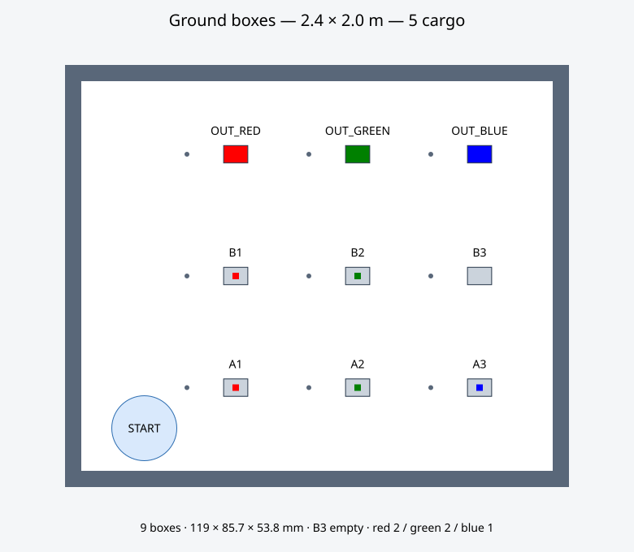
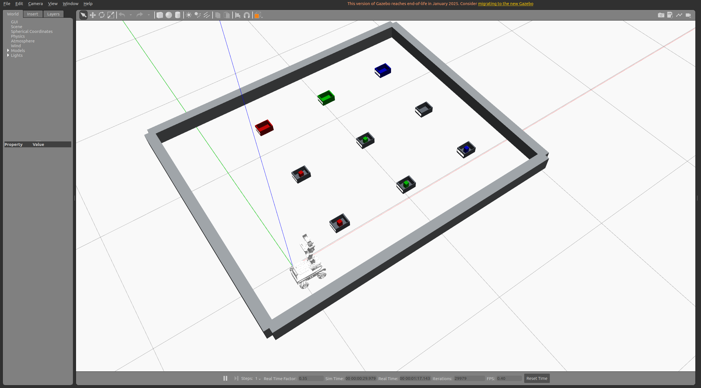

# 2.4×2.0 米地面九盒分拣仿真

场地调整为 **2.4×2.0 m**，保留平面两排三列的六个源盒 A1–A3/B1–B3，以及三个终点盒 OUT_RED、OUT_GREEN、OUT_BLUE。共九个盒子，五件货物分别放在五个不同源盒，B3 留空。

每个盒子内尺寸 **10×8×5 cm**，外尺寸 **11.9×8.57×5.38 cm**，依次对应 x 方向长度、y 方向宽度、z 方向高度。盒体底板厚 3.8 mm，前后壁各 9.5 mm，左右壁各 2.85 mm；四壁保留真实碰撞。九个盒子直接放在地面，没有支架，外底面 z=0，内底面高 0.0038 m，开口顶部高 0.0538 m，名称贴在前侧盒壁。场地边界为 12 cm 高挡边，内侧可用面积约 2.32×1.92 m。

货物暂用 3×3×4.9 cm 长方体，质量 40 g；从货物上部夹取，夹爪主体保持在盒口上方，终点盒可容纳两件并排货物。货物开启重力、摩擦、盒壁、地面及其他货物的物理接触。

| 盒名 | 中心 x/y（m） | 初始货物 / 用途 |
|---|---|---|
| A1 | 0.45 / 0.10 | 红色一件 |
| A2 | 1.05 / 0.10 | 绿色一件 |
| A3 | 1.65 / 0.10 | 蓝色一件 |
| B1 | 0.45 / 0.65 | 红色一件 |
| B2 | 1.05 / 0.65 | 绿色一件 |
| B3 | 1.65 / 0.65 | 空盒，保留 |
| OUT_RED | 0.45 / 1.25 | 接收两件红色货物 |
| OUT_GREEN | 1.05 / 1.25 | 接收两件绿色货物 |
| OUT_BLUE | 1.65 / 1.25 | 接收一件蓝色货物 |



起点 `(0,-0.10)`，场地范围 x∈[-0.35,2.05]、y∈[-0.35,1.65] m。列间距 0.60 m、两排源盒间距 0.55 m、第二排至终点盒间距 0.60 m；底盘规划半径 0.16 m，停靠点位于盒中心前方 0.24 m。配置唯一来源为 `src/landerpi_simulation/config/warehouse.yaml`。机器人使用车上原有 `depth_cam_link` RGB-D 相机；取货前抬臂观察盒内货物，通过拍摄时刻 TF 和顶部深度点估算中心。盒壁遮挡前表面，因此不能继续用原托盘的前表面估计方法。

## 运行

```bash
bash tools/build_simulation.sh
bash tools/run_warehouse_demo.sh
```

自动执行五件货物的取货、按色入盒及返航。只看环境、不自动执行：

```bash
bash tools/run_warehouse_simulation.sh
```

`quantity:=0` 表示当前配置的全部五件货物。三色识别、实际库存、碰撞规划和输出槽位均使用当前配置，不固定为 18 件。`/warehouse/progress` 显示总数、完成数和各颜色数量，`/warehouse/labels` 显示九盒名称及实时数量。

重新生成场景和地图：`python3 tools/generate_warehouse.py`。

## 运动速度

纯仿真默认使用 `motion_profile:=fast`。参数集中在 `src/landerpi_simulation/config/warehouse_motion.yaml`，重新生成场景和地图不会覆盖它们。

| 参数 | fast | legacy |
|---|---:|---:|
| 导航巡航速度上限 | 0.32 m/s | 0.18 m/s |
| 前视距离 | 0.15 m | 0.15 m |
| 位置跟踪增益 | 2.4 | 0.9 |
| 导航控制频率 | 12 Hz | 8 Hz |
| 机械臂速度/加速度比例 | 0.7 / 0.65 | 0.4 / 0.4 |
| 夹爪动作时长 | 0.65 s | 1.0 s |

实际导航使用自定义 `HolonomicController`，通过 `FollowPath.cruise_speed` 和 `FollowPath.lookahead_distance` 控制速度；原来的 DWB `max_vel_x` 等字段不是这个控制器的实际限速。加速版保留到站精度，并限制指令的线性/角加速度；碰撞预测覆盖至少一个制动时间窗口。放置后的落地等待、实际抬升、运输姿态、抓取保持及最终库存验收仍然执行。

```bash
# 默认加速版：五件分类、返航
bash tools/run_warehouse_demo.sh
# 使用原速度参数
bash tools/run_warehouse_demo.sh motion_profile:=legacy
# 单件完整任务对比，任务耗时记录于验收 JSON 与阶段 CSV
bash tools/run_warehouse_test.sh --quantity 1 --motion-profile fast
```

实机入口强制选择 `legacy` 参数；这个加速配置仅默认用于纯仿真。加速版使用更紧的 0.001 rad 关节目标约束，减少小盒口附近的目标采样偏移；不放宽碰撞检查。

同一单件 A1 红货物取货 → OUT_RED 放置 → 返航任务，本机实测任务耗时 **183.9 → 79.8 s**（减少 **56.6%**），导航阶段合计 **79.6 → 26.7 s**。不含启动和等待就绪时间。每版本各测一轮，受仿真实时率及随机规划路径影响；原始阶段记录和结果见 [速度对比](experiments/warehouse_motion_speed/comparison.json)。

最终参数已通过全部五件货物的分类放置、间距、返航和归位验收，任务耗时 **379.2 s**（包含 Nav2 自动恢复），实测底盘峰值约 **0.320 m/s**。详见 [完整验收结果](experiments/warehouse_motion_speed/fast_full.json)。

## 验证

```bash
python3 tools/test_warehouse_layout.py
bash tools/run_warehouse_test.sh
```

检查九盒内外尺寸、五件分置、盒底直接接触地面、导航可达、实际抓取释放、颜色归类、未搬货物不被扰动、盒内间距、返航和机械臂归位。验收不会移动或重置货物。

仍使用理想全向底盘、完美里程计和理想刚性夹持；此仿真验证任务、视觉和运动规划，不能代替实机夹持摩擦和轮胎打滑测试。正常分拣不调用 SetEntityState。

当前 **2.4×2.0 m 地面九盒场景已通过 5/5 完整仿真验收**：红色两件、绿色两件、蓝色一件，全部按色入盒，最后返航、机械臂归位及夹持解除。结果见 [验收 JSON](experiments/warehouse_ground_compact/full_5_acceptance.json)、[任务 CSV](experiments/warehouse_ground_compact/full_5_acceptance.csv) 和 [测试配置](experiments/warehouse_ground_compact/tested_configuration.json)。场景和参数检查 9 项全部通过。低位抓取末端参考点高于盒口 0.5 mm，在 30 mm 理想夹持距离限制内预留至少 3 mm 位置误差余量；规划中包含地面碰撞，盒壁仍保留。

之前带支架的 5/5 与旧托盘 18/18 结果仅作为历史记录。

## Gazebo 显示修复

Gazebo 11 的初始渲染场景通过 Ignition `/scene_info` 服务获取；这个服务不随 `GAZEBO_MASTER_URI` 端口隔离，残留旧仿真可能让新窗口显示旧双桌场景。[Gazebo 11 Scene::Init 源码](https://github.com/gazebosim/gazebo-classic/blob/gazebo11/gazebo/rendering/Scene.cc#L422) 展示了该服务调用。

启动器为每次仿真设置独立 `IGN_PARTITION=landerpi_<端口>`，服务器与客户端共用同一分区，避免混用场景。默认仓库视角已调高，以看清起点机器人和全部框。

独立打开并保留仓库窗口：`python3 tools/start_warehouse_preview.py`。关闭该预览：`python3 tools/stop_warehouse_preview.py`。预览不自动分拣；需要自动分拣时使用前面的 `run_warehouse_demo.sh`。

当前紧凑地面场景的实际 Gazebo 画面：




## 真实手柄与实机底盘

纯仿真不启动手柄或实机节点，也不要求手柄授权。`bash tools/run_warehouse_demo.sh` 自动开始分拣；`bash tools/run_warehouse_simulation.sh` 仅启动场景。
实机模式（`hardware:=true`）启动 `joy_node` 和 `warehouse_joystick.py`，默认手动驾驶，必须按 START 才能开始任务，`autorun` 不绕过此要求。

连接真实底盘并打开仿真：

```bash
bash tools/run_warehouse_hardware.sh
```

纯仿真（不使用手柄、不打开控制板串口）：

```bash
bash tools/run_warehouse_simulation.sh
```

- 默认手动模式：左摇杆上下前进/后退，左右转弯。最大线速度 0.2 m/s，角速度 0.8 rad/s。
- START（默认按钮索引 7）：系统就绪后启动完整导航抓取任务。长按不会重复提交，启动时已经按住的按钮需先松开。
- BACK/SELECT（默认索引 6）：立即停止底盘输出，取消任务；待任务退出后恢复手动。
- 手柄消息超过 0.6 秒未更新：停止底盘并取消任务。重新连接后需再次按 START。
- 自动模式忽略摇杆移动；需要手动接管时先按 BACK。
- `/warehouse/control_mode` 发布 manual / arming / automatic / stopping 状态。

不同手柄可以调整按钮和轴，例如：

```bash
bash tools/run_warehouse_hardware.sh start_button:=9 back_button:=8 linear_axis:=1 angular_axis:=2 joy_device:=0
```

实机入口等价于仓库 launch 加 `hardware:=true`，启动 `ros_robot_controller` 和
`controller/odom_publisher`，底盘速度经 `/cmd_vel` 统一发送，禁用实机里程计发布以避免与 Gazebo TF/里程计冲突。
默认机器类型为 `MentorPi_Mecanum`，可传 `machine_type:=...` 修改。
不要同时运行旧 joystick_control 或另一套底盘驱动，以免争用速度话题或串口。

此模式会让真实底盘跟随仿真速度；定位、感知、机械臂抓放仍在 Gazebo 中完成，
不是基于真实雷达/相机定位的完整实机分拣。应匹配实机与仿真的初始朝向、位置及场地布局。
实机连接需要现有 SDK、串口权限和控制板设备；启动脚本不会自动修复设备权限。

控制测试：`python3 -m unittest discover -s src/landerpi_simulation/tests -v`（先 source ROS、工作区和 `tools/simulation_env.sh`）。
